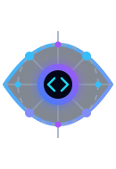
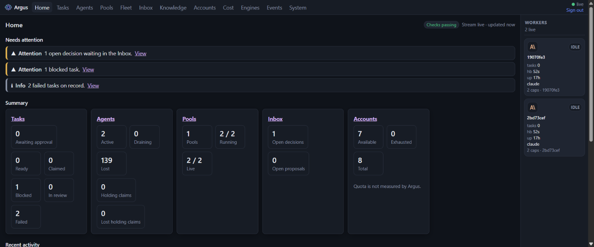
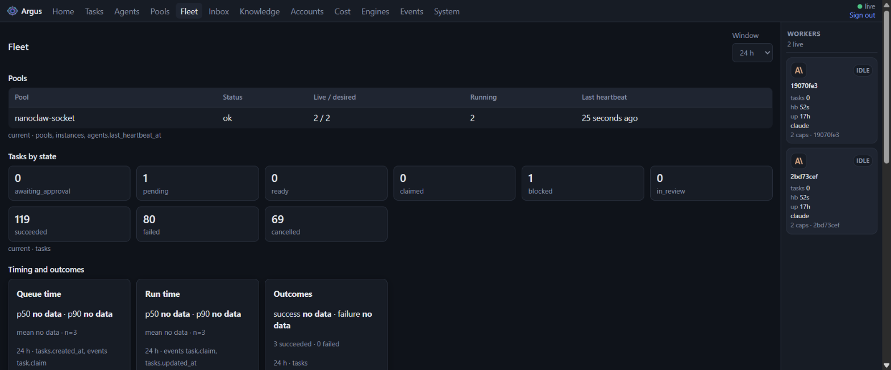
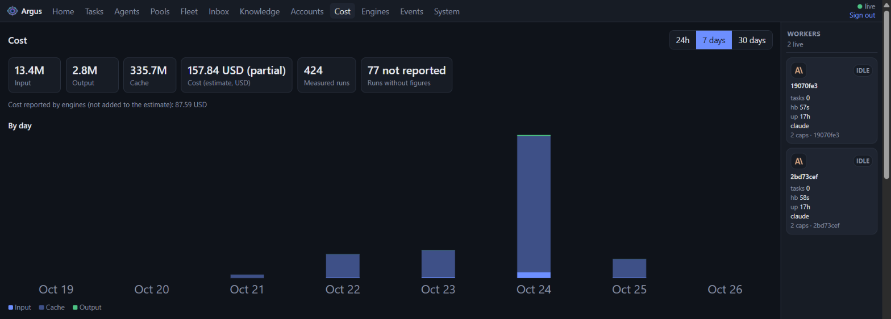
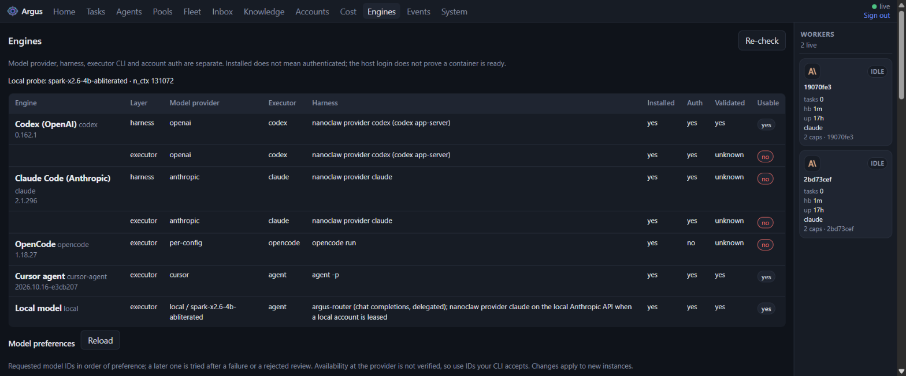
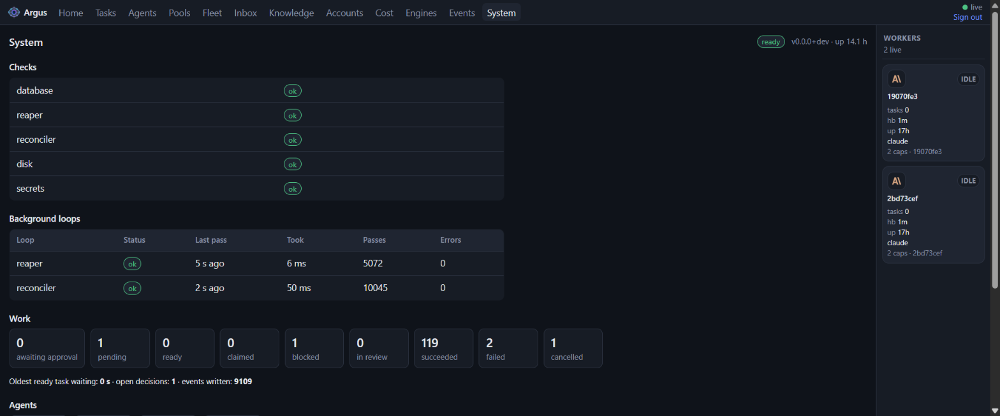

<p align="center">
  
</p>

<h1 align="center">Argus</h1>

<p align="center">
  Control plane for a fleet of AI coding agents. One process, one SQLite file.
</p>

Control plane for a fleet of agents. Argus owns shared state (tasks, agents,
assignments), exposes it to an orchestrator agent and to worker agents through an
API, gives humans a dashboard for visibility, and deploys additional worker
instances (containers) on request from the orchestrator or a user.

**Lightweight and single-node first.** Argus is one process with one SQLite
database (continuously backed up by Litestream) and no required external
services: `docker run -v argus-data:/data argus` is a full deployment. The fleet
it manages can live on remote Docker hosts or Kubernetes; Argus itself stays on
one node. See [`docs/specs/single-node.spec.md`](docs/specs/single-node.spec.md).



<table>
  <tr>
    <td><br><sub><b>Fleet</b>: pool health, tasks by state, queue and run times</sub></td>
    <td><br><sub><b>Cost</b>: tokens and estimated spend per day</sub></td>
  </tr>
  <tr>
    <td><br><sub><b>Engines</b>: agent CLIs (Claude Code, Codex, OpenCode, Cursor, local models)</sub></td>
    <td><br><sub><b>System</b>: health checks, background loops, work counts</sub></td>
  </tr>
</table>

## Layout

- `apps/api/` — FastAPI control-plane API (Python, `argus_api`).
- `apps/dashboard/` — Operator dashboard (Vite + React + TypeScript), served by
  the API process in production.
- `packages/core/` — Shared domain types (Python, `argus_core`).
- `docs/` — Specs and drafts. Spec first: nothing is built before it is written
  down in `docs/specs/` (see [`docs/README.md`](docs/README.md)).
- `integrations/nanoclaw/` — NanoClaw channel that makes a NanoClaw agent group an
  Argus worker (installed into a NanoClaw checkout).
- `examples/echo-worker/` — Minimal worker speaking the Argus API (reference and
  integration-test image).
- `deploy/` — Dockerfiles and Compose (`compose.yaml`). `.gitea/` — CI.

## Development

Requires `uv`, [mise](https://mise.jdx.dev) (pins Python, Node, pnpm, uv, gitleaks; `mise install`). Docker only for the `docker` target and image builds.

```bash
make setup        # uv sync + pnpm install
make hooks        # enable the pre-push hook: make check + build + secret scan, skips trees that passed
make dev-api      # API on :8000 under /api (state in ./data, override with ARGUS_DATA_DIR)
make dev-dashboard # http://localhost:3000, proxies /api to :8000
make check        # lint + typecheck + test (what CI runs)
```

## Run with Docker

One process, one volume ([single-node](docs/specs/single-node.spec.md)). From a
clone:

```bash
docker compose -f deploy/compose.yaml up --build
# Dashboard: http://127.0.0.1:8000
docker compose -f deploy/compose.yaml exec argus cat /data/admin-token
```

Or without Compose:

```bash
docker build -f deploy/Dockerfile.api -t argus .
docker run --name argus -d -p 127.0.0.1:8000:8000 -v argus-data:/data argus
docker exec argus cat /data/admin-token
```

A release tag also publishes the image to this repo's container registry
([releases](docs/specs/releases.spec.md)); pull `…/argus:vX.Y.Z` instead of
building when you have registry access.

Publish on loopback as above: Argus serves plain HTTP and ships no reverse
proxy, so TLS must terminate at a proxy you run in front of it before exposing
it beyond this host. Exposure is the `-p` / Compose `ports` address.

- Preset the admin token with `-e ARGUS_ADMIN_TOKEN=<32+ chars>` (otherwise
  first start writes `/data/admin-token`, never logged).
- Provider accounts: mount an age key so Argus can read/write its SOPS file:
  `-v ./age-key.txt:/keys/age.txt:ro -e SOPS_AGE_KEY_FILE=/keys/age.txt`
  `-e SOPS_AGE_RECIPIENTS=age1…` (`age-keygen -o age-key.txt`).
- Local Docker pools on Linux: merge the overlay to mount the socket and publish
  the API on Docker's bridge gateway, where workers reach it through
  `host.docker.internal`. The dashboard remains available on loopback:

  ```bash
  DOCKER_GID=$(stat -c %g /var/run/docker.sock) \
    DOCKER_BRIDGE_IP=$(docker network inspect bridge --format '{{(index .IPAM.Config 0).Gateway}}') \
    docker compose -f deploy/compose.yaml -f deploy/compose.docker.yaml up --build
  ```

- Continuous backup: `-e LITESTREAM_REPLICA_URL=s3://bucket/argus` (plus
  `LITESTREAM_ACCESS_KEY_ID` / `LITESTREAM_SECRET_ACCESS_KEY`).

CI builds and boots the control-plane image, and builds the NanoClaw host and
echo-worker images, on every `main` push and when their inputs change on a PR
(`.gitea/workflows/quality.yaml`).

## Operating it

| Endpoint | Auth | Use |
| --- | --- | --- |
| `GET /healthz` | none | liveness: the process is up |
| `GET /readyz` | none | readiness: `503` when the database is unreadable or the writer is held over 5 s, a loop stalled, or the disk is full (`degraded` is still `200`); never takes the writer, result cached ~2 s |
| `GET /api/metrics` | admin token | Prometheus text: tasks, agents, pools, accounts, queue age, loop health, DB and disk size |
| `GET /api/system` | any token | the same facts as JSON; the dashboard's System tab |

```yaml
# prometheus.yml
scrape_configs:
  - job_name: argus
    metrics_path: /api/metrics
    authorization: { credentials: argus_admin_… }   # an admin token labeled "prometheus"
    static_configs: [{ targets: ["argus:8000"] }]
```

A good first alert is `argus_task_oldest_ready_age_seconds` growing while
`argus_agents{state="active"}` is 0, or `argus_pool_status{status!="ok"} == 1`.

## Workers on Kubernetes

A pool with `target: kubernetes` runs each instance as a Pod. Give it an explicit
kubeconfig context (or `in-cluster`) and a namespace; Argus never uses the
kubeconfig's current context.

```bash
kubectl create namespace workers
kubectl apply -n workers -f deploy/kubernetes/rbac.yaml   # least-privilege Role
curl -X PUT $ARGUS/api/pools/kw -H "Authorization: Bearer $ADMIN" \
  -H 'Content-Type: application/json' -d '{
  "target": "kubernetes", "image": "registry.example/worker:1",
  "desired_replicas": 2, "max_replicas": 5,
  "kubernetes": {"context": "my-cluster", "namespace": "workers"}
}'
```

Pods must be able to reach `ARGUS_PUBLIC_URL`. Try it on a throwaway cluster with
`make test-k8s` (kind; see the target's comment).

## Connecting agents (MCP)

Argus serves an MCP endpoint at `/mcp`. Register an agent (mint a bootstrap
token in the dashboard, then `POST /api/agents/register`) and give the MCP client
its token, for example with Claude Code:

```bash
claude mcp add --transport http argus http://localhost:8000/mcp \
  --header "Authorization: Bearer argus_agent_…"
```

The tools cover the whole loop: `claim_task`, `heartbeat`, `report_progress`,
`complete_task`, `ask_question`, knowledge search and writes, and account leasing
with quota fallback.

