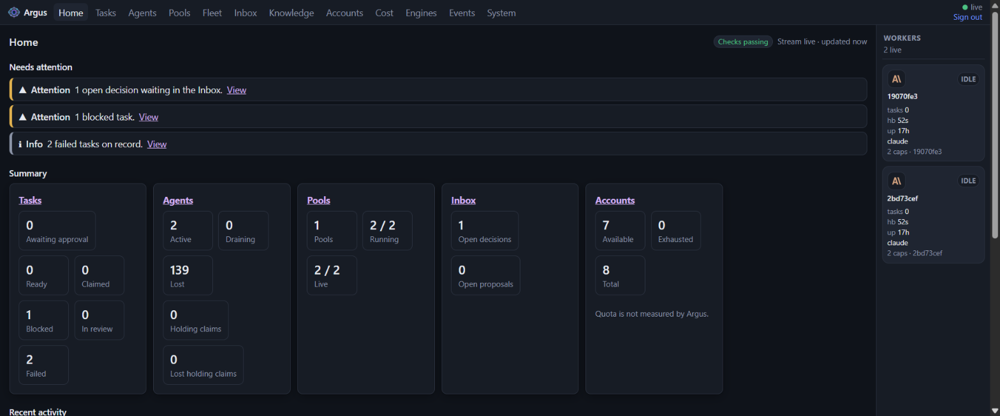
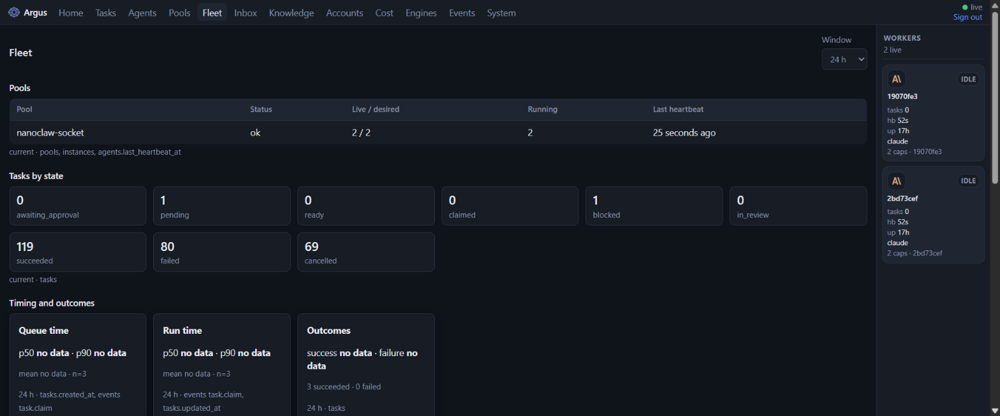
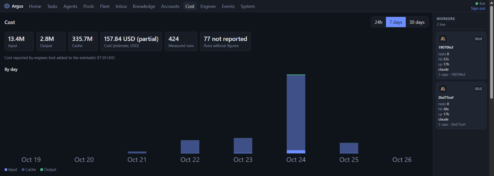
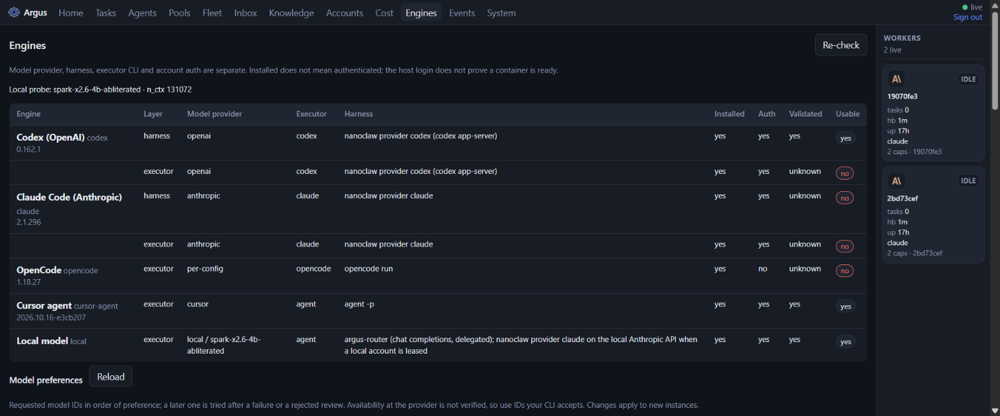
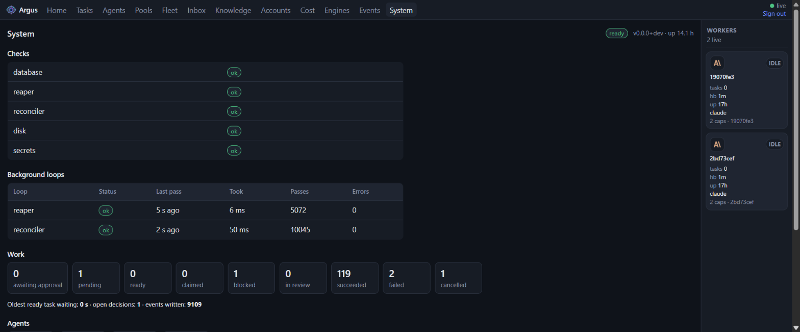

<p align="center">
  
</p>

<h1 align="center">Argus</h1>

<p align="center">
  Control plane for a fleet of AI coding agents. One process, one SQLite file.
</p>

<p align="center">
  <a href="https://github.com/2Mundos/argus/actions/workflows/quality.yaml"></a>
  <a href="https://github.com/2Mundos/argus/releases/latest"></a>
  <a href="LICENSE"></a>
  <a href="https://github.com/orgs/2Mundos/packages/container/package/argus"></a>
</p>

**For** teams and solo developers who run several AI coding agents (Claude Code,
Codex, Cursor, Copilot, local models) against their repositories and want them
to share one queue instead of a pile of terminals.

**The problem:** each agent works alone. Nobody knows who is on which task,
work stalls when a subscription's quota runs out, and token spend is invisible
until the bill arrives.

**Why Argus?** It is the one place that hands out work, keeps it moving across
accounts, and shows what it cost, and it deploys as a single container with no
database server, broker or cloud service to run next to it.

- **Leased task queue.** Workers claim tasks under a lease and heartbeat it; an
  expired lease puts the task back, and retries, dependencies, blocking and
  steering are built in ([worker lifecycle](docs/specs/worker-lifecycle.spec.md)).
- **Account failover on quota.** Provider accounts are leased by priority and
  availability; when one hits its quota the task goes back to the queue without
  spending an attempt and runs on the next usable account, or waits until one
  resets ([account selection](docs/specs/account-selection.spec.md)).
- **MCP for your agents.** Claude Code, Codex and other MCP clients connect to
  `/mcp` to claim, report and complete tasks ([MCP](#connecting-agents-mcp)).
- **Cost and usage dashboard.** Tokens and estimated spend per project,
  account and day, next to fleet health and live work ([cost view](docs/specs/cost-view.spec.md)).
- **Worker pools anywhere.** Argus starts worker containers on local or remote
  Docker hosts or Kubernetes, on request from the orchestrator or a user.

Argus owns shared state (tasks, agents, assignments), exposes it to an orchestrator agent and to worker agents through an
API, gives humans a dashboard for visibility, and deploys additional worker
instances (containers) on request from the orchestrator or a user.

**Lightweight and single-node first.** Argus is one process with one SQLite
database (continuously backed up by Litestream) and no required external
services: `docker run -v argus-data:/data ghcr.io/2mundos/argus:latest` is a full deployment. The fleet
it manages can live on remote Docker hosts or Kubernetes; Argus itself stays on
one node. See [`docs/specs/single-node.spec.md`](docs/specs/single-node.spec.md).



<details>
<summary>More screenshots: Fleet, Cost, Engines, System</summary>

**Fleet**: pool health, tasks by state, queue and run times.


**Cost**: tokens and estimated spend per day.


**Engines**: agent CLIs (Claude Code, Codex, OpenCode, Cursor, local models).


**System**: health checks, background loops, work counts.


</details>

## Quickstart

Needs Docker and curl (Linux, macOS, or Windows with WSL 2).

```bash
curl -fsSL https://github.com/2Mundos/argus/releases/latest/download/install.sh | sh
argus up   # asks whether to set up workers, then prints the dashboard URL and admin token
```

Workers run the coding agents in Docker on this machine. Saying yes gives
Argus the Docker socket (root-equivalent on that host) and pulls about 7 GB.
`argus up --workers` or `--no-workers` answers without asking; later,
`argus worker setup` or `argus worker remove` changes it.

This installs the newest [release](https://github.com/2Mundos/argus/releases).
To pin one instead, set `ARGUS_VERSION=vX.Y.Z` for the installer and pass
`--version vX.Y.Z` to the first `argus up`; later, `argus update vX.Y.Z`
moves to a chosen release.

To upgrade, run `argus update`. It shows the release notes, backs up the
database, upgrades, and rolls back if the new version does not start.
`argus status`, `argus backup`, `argus restore <name>`, `argus logs` and
`argus down` cover the rest ([launcher](docs/specs/launcher.spec.md)). Settings
live in `~/.config/argus/`; keep a copy of `age-key.txt` there, since it decrypts
provider credentials. `argus uninstall` removes everything the launcher
created after listing it; `--keep-data` keeps the data for a later install.

The manual route (plain `docker run`, Compose, building from source) is under
[Run with Docker](#run-with-docker).

## Layout

- `apps/api/` — FastAPI control-plane API (Python, `argus_api`).
- `apps/dashboard/` — Operator dashboard (Vite + React + TypeScript), served by
  the API process in production.
- `packages/core/` — Shared domain types (Python, `argus_core`).
- `docs/` — Specs and drafts. Spec first: nothing is built before it is written
  down in `docs/specs/` (see [`docs/README.md`](docs/README.md)).
- `integrations/nanoclaw/` — NanoClaw channel that makes a NanoClaw agent group an
  Argus worker (installed into a NanoClaw checkout).
- `examples/echo-worker/` — Minimal worker speaking the Argus API (reference and
  integration-test image).
- `deploy/` — Dockerfiles and Compose (`compose.yaml`). `.github/` — CI.

## Development

Requires `uv`, [mise](https://mise.jdx.dev) (pins Python, Node, pnpm, uv, gitleaks; `mise install`). Docker only for the `docker` target and image builds.

```bash
make setup        # uv sync + pnpm install
make hooks        # enable the pre-push hook: make check-changed + secret scan
make dev-api      # API under /api on this checkout's own port; state in ./.argus (seeded from the preview DB; DATA_DIR=, NO_SEED=1)
make dev-dashboard # this checkout's dashboard port, proxies /api to its dev-api; both print one `dev:` line
make seed-dev     # re-seed ./.argus from a pruned copy of the preview DB (ACCOUNTS=1 adds accounts)
make check        # lint + typecheck + test (what CI runs)
make check-changed # only what changed since origin/main's merge base can affect (full check if unknown)
```

### Replay worker (dev only)

Watch a task flow through a local Argus with no model: `argus-replay` claims the
next task that requires the `replay` capability and plays a recorded attempt back
through the MCP tools a worker uses. Off unless `ARGUS_DEV_REPLAY=1`.

```bash
curl -s -X POST localhost:8000/api/tasks -H "Authorization: Bearer $ARGUS_ADMIN_TOKEN" \
  -H 'content-type: application/json' \
  -d '{"project":"<project>","title":"replay me","required_capabilities":["replay"]}'
ARGUS_DEV_REPLAY=1 ARGUS_ADMIN_TOKEN=... uv run argus-replay \
  --fixture apps/api/tests/fixtures/replay/sample-attempt.json --speed 4
```

Steers and cancels sent during playback are honoured. A fixture holds the event
stream only (log lines, progress, model reports, final output); the workspace diff
is not recorded, so task changes and delivery are not replayed. Point it at a dev
instance: an untagged task matches every worker, and the command refuses it.
Record a fixture from a **copy** of a database, then review it before committing:
`ARGUS_DB=copy.db scripts/record_attempt.py <task_id> <attempt> -o fixture.json`
(secrets and absolute paths are redacted; times are offsets from the first step).

## Run with Docker

The [Quickstart](#quickstart) launcher does all of this for you; this section is
the manual equivalent. One process, one volume ([single-node](docs/specs/single-node.spec.md)): the
same port serves the dashboard at `/` and the API under `/api`. Every release
publishes the image to `ghcr.io/2mundos/argus:vX.Y.Z` and moves `latest` to the
newest one (versions are on the [releases
page](https://github.com/2Mundos/argus/releases), see
[releases](docs/specs/releases.spec.md)). `latest` is fine for trying Argus; a
deployment pins a version and upgrades on purpose, after reading the release
notes: a release with a migration cannot be rolled back by switching images.
To pin, replace `latest` below with a release tag (`vX.Y.Z`).

```bash
docker run --name argus -d -p 127.0.0.1:8000:8000 -v argus-data:/data \
  ghcr.io/2mundos/argus:latest
until docker exec argus test -s /data/admin-token 2>/dev/null; do sleep 1; done   # first start takes a while
docker exec argus cat /data/admin-token   # sign in with this
# Dashboard: http://127.0.0.1:8000
```

`-p` publishes the port on this host only and `-v` keeps the database, the
admin token and artifacts across restarts and upgrades; without them the
dashboard is unreachable and the state is lost with the container.

To build from a clone instead:

```bash
docker compose -f deploy/compose.yaml up --build
docker compose -f deploy/compose.yaml exec argus cat /data/admin-token
```

or without Compose, `docker build -f deploy/Dockerfile.api -t argus .` and the
`docker run` above with `argus` as the image.

Publish on loopback as above: Argus serves plain HTTP and ships no reverse
proxy, so TLS must terminate at a proxy you run in front of it before exposing
it beyond this host. Exposure is the `-p` / Compose `ports` address.

- Preset the admin token with `-e ARGUS_ADMIN_TOKEN=<32+ chars>` (otherwise
  first start writes `/data/admin-token`, never logged).
- Provider accounts: mount an age key so Argus can read/write its SOPS file:
  `-v ./age-key.txt:/keys/age.txt:ro -e SOPS_AGE_KEY_FILE=/keys/age.txt`
  `-e SOPS_AGE_RECIPIENTS=age1…` (`age-keygen -o age-key.txt`).
- Workers: `-e ARGUS_PUBLIC_URL=<url>` is the address workers use to call this
  Argus. Until it is set, Argus starts no worker and the Agents page says
  so; the dashboard and API work without it. Local Docker pools use
  `http://host.docker.internal:8000` (the Compose files set it, see below);
  remote hosts and Kubernetes use the URL of the TLS proxy in front of Argus.
- Local Docker pools on Linux: merge the overlay to mount the socket and publish
  the API on Docker's bridge gateway, where workers reach it through
  `host.docker.internal`. The dashboard remains available on loopback:

  ```bash
  DOCKER_GID=$(stat -c %g /var/run/docker.sock) \
    DOCKER_BRIDGE_IP=$(docker network inspect bridge --format '{{(index .IPAM.Config 0).Gateway}}') \
    docker compose -f deploy/compose.yaml -f deploy/compose.docker.yaml up --build
  ```

- Continuous backup: `-e LITESTREAM_REPLICA_URL=s3://bucket/argus` (plus
  `LITESTREAM_ACCESS_KEY_ID` / `LITESTREAM_SECRET_ACCESS_KEY`).

CI builds and boots the control-plane image, and builds the NanoClaw host and
echo-worker images, on every `main` push and when their inputs change on a PR
(`.github/workflows/quality.yaml`).

## Operating it

| Endpoint | Auth | Use |
| --- | --- | --- |
| `GET /healthz` | none | liveness: the process is up |
| `GET /readyz` | none | readiness: `503` when the database is unreadable or the writer is held over 5 s, a loop stalled, or the disk is full (`degraded` is still `200`); never takes the writer, result cached ~2 s |
| `GET /api/metrics` | admin token | Prometheus text: tasks, agents, pools, accounts, queue age, loop health, DB and disk size |
| `GET /api/system` | any token | the same facts as JSON; the dashboard's System tab |

```yaml
# prometheus.yml
scrape_configs:
  - job_name: argus
    metrics_path: /api/metrics
    authorization: { credentials: argus_admin_… }   # an admin token labeled "prometheus"
    static_configs: [{ targets: ["argus:8000"] }]
```

A good first alert is `argus_task_oldest_ready_age_seconds` growing while
`argus_agents{state="active"}` is 0, or `argus_pool_status{status!="ok"} == 1`.

## Workers on Kubernetes

A pool with `target: kubernetes` runs each instance as a Pod. Give it an explicit
kubeconfig context (or `in-cluster`) and a namespace; Argus never uses the
kubeconfig's current context.

```bash
kubectl create namespace workers
kubectl apply -n workers -f deploy/kubernetes/rbac.yaml   # least-privilege Role
curl -X PUT $ARGUS/api/pools/kw -H "Authorization: Bearer $ADMIN" \
  -H 'Content-Type: application/json' -d '{
  "target": "kubernetes", "image": "registry.example/worker:1",
  "desired_replicas": 2, "max_replicas": 5,
  "kubernetes": {"context": "my-cluster", "namespace": "workers"}
}'
```

Pods must be able to reach `ARGUS_PUBLIC_URL`. Try it on a throwaway cluster with
`make test-k8s` (kind; see the target's comment).

## Connecting agents (MCP)

Argus serves an MCP endpoint at `/mcp`. Register an agent (mint a bootstrap
token in the dashboard, then `POST /api/agents/register`) and give the MCP client
its token, for example with Claude Code:

```bash
claude mcp add --transport http argus http://localhost:8000/mcp \
  --header "Authorization: Bearer argus_agent_…"
```

The tools cover the whole loop: `claim_task`, `heartbeat`, `report_progress`,
`complete_task`, `ask_question`, knowledge search and writes, and account leasing
with quota fallback.


## Contributing

See [`CONTRIBUTING.md`](CONTRIBUTING.md) and the [Code of Conduct](CODE_OF_CONDUCT.md).
Report vulnerabilities privately ([`SECURITY.md`](SECURITY.md)).

## License

Apache License 2.0. See [`LICENSE`](LICENSE).
