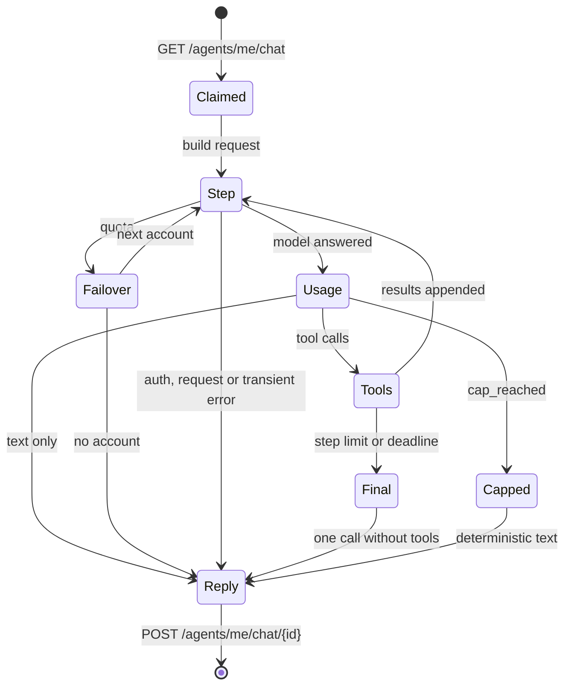

# Built-in Orchestrator Runtime

# 1. Purpose and Scope

The [internal orchestrator](internal-orchestrator.spec.md) runs today only as a
NanoClaw system pool. Before an admin can send a first chat message, the node must
pass the whole `nanoclaw-orchestrator` template readiness (`fleet/templates.py`
`_judge`):

- `ARGUS_PUBLIC_URL` is set;
- Docker is reachable;
- the NanoClaw host and agent images are installed;
- the OneCLI gateway runs.

After that, the reconciler starts a container, the channel registers the Argus MCP
server with OneCLI, leases an account, and only then claims the message. On a fresh
install that is the longest part of [onboarding](onboarding.spec.md), and it is all
for an agent that never uses a shell, a workspace or a file: its persona allows
only the Argus MCP tools.

This spec adds a second runtime for the same orchestrator, **`builtin`**. It is an
agent loop that runs as asyncio tasks inside the Argus process, calls a model API
over HTTP, and reaches Argus only through the existing REST chat routes and MCP
tools. With an API-key account (Anthropic, OpenAI, an OpenAI-compatible endpoint,
or a local model), enabling the orchestrator needs no Docker, no image, no OneCLI
and no public URL, so chat works within a minute or two of adding the account.

The built-in orchestrator is the same **agent**, with the same contract. It holds
the same `orchestrator` scope and the same `403 internal_orchestrator` refusals,
uses the same chat routes, `argus-orchestrator` skill, conversations, Updates
thread, inbox wake and sweep, daily cap and cost attribution. The only new parts
are where it runs and what speaks to the model. Everything the
[internal orchestrator](internal-orchestrator.spec.md) spec says holds for both
runtimes unless this spec names an exception.

In scope:

- The `orchestrator.runtime` setting and how a runtime is chosen (3.1).
- The in-process fleet target that hosts the built-in instance (3.2).
- The loop: identity, accounts, model adapters, prompt, tools, turns, concurrency,
  failover and spend (3.3 to 3.9).
- Task update notices to a task's origin conversation, for both runtimes (3.10).
- Local model detection for an easier `local` account (3.11).
- Security, observability, the dashboard, entry points, engines, the way back and
  settings (3.12 to 3.18).

**What it does not speed up.** Tasks still need a worker. A task the orchestrator
creates waits in `ready` until a pool can claim it, and creating a worker still goes
through the [worker launch](worker-launch.spec.md) templates. The built-in makes
chat and orchestration available early; it does not make workers cheaper to set up.

# 2. Non-Goals

- **Not a worker runtime.** The built-in never claims tasks, runs code, opens a
  shell or touches a workspace. Workers stay NanoClaw or `plain` pools.
- **No subscription credentials.** Claude `setup-token` and `claudeAiOauth`
  credentials, ChatGPT logins, Copilot tokens and Cursor logins are issued to their
  own CLIs. The built-in never leases them (3.4). Installs with only such accounts
  use the NanoClaw runtime.
- **No vendor SDK.** The adapters are plain HTTP on the project's existing client
  (`httpx2`). No `anthropic` or `openai` package is added.
- **No removal of the NanoClaw runtime.** Both runtimes are supported. Neither is
  deprecated by this spec.
- **No new authority.** The built-in gets nothing an internal orchestrator does
  not already have, and it reaches everything through REST, so the checks stay in
  the routes ([internal orchestrator](internal-orchestrator.spec.md) 3.5).
- **No automatic runtime switching.** `auto` is resolved when the orchestrator is
  enabled (3.1), never later because accounts changed.
- **No tool transcript across turns.** Each turn starts from the thread's messages
  and the tasks it originated (3.5). Tool calls and their results live only for the
  turn that made them.
- **No token streaming**, no per-conversation model choice, and no chat for
  external orchestrators. These are unchanged from the internal orchestrator spec.
- **No new required service.** Model providers are reached only when an admin has
  added an account and enabled the orchestrator
  ([single node](single-node.spec.md) 3.5).

# 3. Decisions Made

## 3.1 Runtimes and how one is chosen

There are two runtimes for the one system pool:

| Runtime | Runs in | Model access | Needs |
| --- | --- | --- | --- |
| `nanoclaw` | a NanoClaw host container (today's behaviour) | Claude Code or Codex in agent containers, credentials through OneCLI | the `nanoclaw-orchestrator` template ready |
| `builtin` | asyncio tasks in the Argus process | direct HTTP to the model API with the leased key | one built-in-capable account (3.4) |

**Setting.** `orchestrator.runtime` is `auto` (default), `builtin` or `nanoclaw`
(global, admin-written, [settings](settings.spec.md) registry). It says which
runtime the system pool gets the next time it is created or converged by enabling.

**Resolution.** Resolution runs outside the write transaction, because it probes
the node, as `pick_sandboxed` does today. Then the enable write converges the pool
in its own transaction:

- `builtin`: at least one **built-in-capable** account exists and is not `disabled`
  (3.4). If none exists, the enable is refused with `409 builtin_no_account`.
- `nanoclaw`: the `nanoclaw-orchestrator` template is ready. If it is not, the
  enable is refused with `409 template_not_ready` and its blockers, as today.
- `auto`: `builtin` if it would be accepted, else `nanoclaw` if it would be
  accepted. If neither, the enable is refused with `409 orchestrator_unavailable`,
  whose details list both reasons: "no API-key, custom or local account" and the
  template blockers.

An exhausted account still counts as capable, because it recovers at its reset.
Its turns wait like any offline period
([internal orchestrator](internal-orchestrator.spec.md) 3.3).

**When it runs.** Resolution runs when `orchestrator.enabled` goes from false to
true, and when `orchestrator.runtime` is written while the orchestrator is enabled.
Once resolved, the runtime is the system pool's `runtime`, and the pool keeps it
until one of those two events happens again. Adding or deleting accounts never
switches it.

**Switching needs a stopped orchestrator.** A pool's target and runtime decide how
its instances are stopped, so they never change under a live instance. When
resolution picks a runtime other than the pool's current one and the pool still
has an instance that is not `terminated`, the write is refused with
`409 orchestrator_running`: "disable the orchestrator and wait until it has
stopped". Writing `orchestrator.runtime` while the orchestrator is disabled only
stores the value. The pool converges at the next enable.

**Onboarding.** `GET /api/onboarding` gains `orchestrator_runtime`: the runtime
`auto` would resolve to now (`builtin`, `nanoclaw`, or `null` when neither is
accepted), and `builtin_account`: the name of the best-ranked built-in-capable
account, or `null`. Step 3 of the wizard uses them (3.14).

## 3.2 Hosting: the in-process target

The built-in instance is a normal `instances` row of the system pool, with a normal
agent registered from a bootstrap token. Pool, instance, agent, heartbeat, drain,
lost detection, crash-loop hold, the chat status header and the agent drawer
therefore keep working with no runtime-specific code.

**Pool shape.** When the runtime resolves to `builtin`, `apply_enabled` creates
or replaces the `orchestrator` pool with:

| Field | Value |
| --- | --- |
| `system` | `orchestrator` |
| `runtime` | `builtin` (new `RuntimeKind.BUILTIN`) |
| `target` | `inprocess` (new `TargetKind.INPROCESS`) |
| `image` | the constant `builtin` (nothing is pulled) |
| `capabilities` | `[]` |
| `agents_per_instance`, `max_replicas` | `1`, `1` |
| `docker`, `kubernetes`, `nanoclaw`, `env` | absent or empty |
| `desired_replicas` | `1` when enabled, `0` when disabled |

`PoolUpsert` accepts `target: inprocess` only together with `runtime: builtin`,
and the reverse. It accepts that pair only from `apply_enabled`. An admin
`PUT /api/fleet/pools/{name}` naming it answers `422 inprocess_system_only`. The
pool editor shows the built-in pool read-only. Its image is not editable, and an
image change answers `409 system_pool`, which is the one difference from a
NanoClaw system pool.

**Migration.** `pools.target` and `pools.runtime` carry `CHECK` constraints from
`0011_fleet.sql`. Migration `0075_builtin_orchestrator.sql` rebuilds `pools` with
the widened checks (`target IN ('docker', 'kubernetes', 'inprocess')`,
`runtime IN ('plain', 'nanoclaw', 'builtin')`) and one more,
`(target = 'inprocess') = (runtime = 'builtin')`. It uses SQLite's table-rebuild
procedure: copy into a new table, drop, rename, and recreate the index. It keeps
every column added since `0011`, including `system` (`0056`) and the OOM streak
(`0061`). No other table changes.

SQLite ignores `PRAGMA foreign_keys` inside a transaction, and every migration
runs in one. A migration whose SQL holds the line `-- argus: foreign keys off`
therefore runs with foreign keys turned off around it, and the same transaction
ends with a check of `pragma_foreign_key_check`. A dangling reference the
database already had (an earlier write left a child row pointing at a missing
parent) is kept as it is; the runner deletes or rewrites nothing. It records
them in the transaction before the migration runs, each as the child table, the
child row's primary key, the parent table, and the referencing columns with
their values. Any other dangling reference after the migration fails it and
rolls it back. That includes a new one, and an old one whose value changed or
that moved to another row. `foreign_key_check` names no row in a `WITHOUT ROWID`
table, so a dangling reference there is never kept. `instances.pool` still
references `pools` by name afterwards.

**`InProcessTarget`** implements the `Target` protocol in `fleet/targets.py` and
is registered in `TargetRegistry` under `inprocess`. It holds a table of running
loops in memory, keyed by instance id.

| Method | Behaviour |
| --- | --- |
| `start(spec)` | If a loop for `spec.instance_id` is running, return its ref (the reconciler may retry a start). Otherwise create an asyncio task running the loop with `spec.env`, and return ref `inprocess:<instance id>`. |
| `list(labels)` | One `ProviderInstance` per loop matching the labels: `running` while the task runs; `exited` with `exit_code` `0` after a clean leave, `1` after an unhandled error. An exited loop stays listed until `stop`, as an exited container does. |
| `stop(ref, grace)` | Ask the loop to drain (3.8), wait up to `grace` for turns in flight, then cancel the task and drop it from the table. Unknown refs are a no-op. |
| `logs(ref, tail)` | The last `tail` lines of the loop's log ring (500 lines, 3.13). |
| `probe()` | Always reachable: `TargetInfo(version="inprocess")`. |
| `image_present` | `True`. |
| `labeled_images`, `list_by_label` | `[]`: there are no images and no descendant containers. |
| `pause`, `unpause` | `TargetError("in-process instances cannot be paused")`. |

**Reconciler.** `_scale` requires `ARGUS_PUBLIC_URL` only for pools whose target
is not `inprocess`. `container_spec` gains a `builtin` branch. Its env holds only
`ARGUS_BOOTSTRAP_TOKENS`, `ARGUS_INSTANCE_ID`, `ARGUS_POOL`,
`ARGUS_AGENT_ROLE=orchestrator` and `ARGUS_URL=inprocess`. The loop reaches the
app through an ASGI transport, never through a URL. Everything else in
`_decide`, `_scale` and `_act` is unchanged. In particular a fresh bootstrap token
is minted for every start, with `role: orchestrator`.

**Crash.** An unhandled exception in the loop logs its type and message (never a
credential, prompt or tool result) and ends the task. `list` then reports
`exited`/`1`. The reconciler treats it like a container that exited: it replaces
the instance, and `_crash_loop_hold` applies.

**Process stop.** The app lifespan stops every loop through the same `stop` path,
with `FleetSettings.stop_grace`, before it closes the database. A turn still
running when the grace runs out gets one reply, "Argus stopped during this turn.
Send the message again.", posted with its `turn_id` (3.7), and then the loop
leaves (3.3). After a restart `list` is empty. The reconciler sees the instance's
loop missing and replaces it, as for a vanished container, and the new loop
registers again.

## 3.3 Identity and wiring

- **One client into the app.** The loop makes every REST and MCP call with an
  `httpx2.AsyncClient` on an `ASGITransport` of the running app, with
  `base_url="http://localhost"`. `localhost` is on the MCP host allowlist
  (`allowed_mcp_hosts`). The bearer token is the agent token from registration.
  There is no network hop, and every call passes through the same authentication,
  scope and route checks as a remote agent's.
- **Register.** `POST /api/agents/register` with the first bootstrap token. The
  agent's `runtime` reports `worker_version` (the Argus version) and
  `features: ["builtin"]`. `engine` and `executor` stay null, because the built-in
  is not a harness engine in the [engines](engines.spec.md) catalogue.
- **Heartbeat.** `POST /api/agents/me/heartbeat` every `heartbeat_interval_s`
  from the registration response, with no leases, from its own task. The heartbeat
  renews the agent token as it does for any agent. A heartbeat answering
  `state: draining` starts the drain (3.8).
- **Leave.** After a drain or a stop, `POST /api/agents/me/leave`, then the task
  returns normally (`exit_code` `0`).
- **Attribution.** Tool actions are attributed `orchestrator:<agent id>` and
  carry `actor_internal: true`, because the agent belongs to the system pool
  (`agent_system_pool`).
- **Skill and persona.** At startup the loop reads
  `skill://argus-orchestrator/SKILL.md` with MCP `resources/read` and keeps it for
  the life of the loop. The skill cannot change without a process restart, which
  also restarts the loop.

## 3.4 Accounts and models

**Built-in-capable accounts:**

| Provider | Kind | Condition | API |
| --- | --- | --- | --- |
| `anthropic` | `api_key` | none | Anthropic Messages |
| `openai` | `api_key` | none | OpenAI Chat Completions |
| `custom` | `api_key` | an `engine` role `model` ([custom accounts](custom-accounts.spec.md)) | OpenAI-compatible Chat Completions at its `base_url` |
| `local` | any | none ([local harness](local-harness.spec.md)) | OpenAI-compatible Chat Completions at its `base_url` |

**Lease.** The loop leases its engine with no task, as the system pool already
may ([account selection](account-selection.spec.md)):

```json
{"role": "engine",
 "runtime_providers": ["anthropic", "openai", "custom", "local"],
 "credential_kinds": ["api_key"]}
```

`credential_kinds` is a new optional `LeaseRequest` field. It narrows eligibility
to accounts of those kinds and never orders them, like `runtime_providers`. It is
accepted from every caller. `ExhaustedReport` takes it too, so the next account
the report names is one the built-in can lease. NanoClaw does not send it, so its leases are
unchanged. `local` accounts pass because their credential holds no secret and they
are stored as `api_key`. The ranking, `max_leases`, recovery after a reset and the
`orchestrator.model` preference are unchanged. The loop holds one engine lease
for all its turns (3.8).

**Which model runs**, first match wins:

1. `anthropic` or `openai`: the lease's `model`, which is set when
   `orchestrator.model` names that provider's engine (`claude/<model>` for
   `anthropic`, `codex/<model>` for `openai`). Next comes the first model of the
   host model policy's harness chain for that engine
   ([model selection](model-selection.spec.md)). With neither, the turn is not sent:
   its reply is "No model is configured for `<provider>`: set
   `orchestrator.model` or the model policy."
2. `custom`: the lease `settings.model` (the account's `engine` model).
3. `local`: the lease `settings.model`, else the account credential's `model`,
   else the model the local probe reports as served. The lease route fills
   `settings.model` from the probe when the account names none, as it fills
   `context_tokens`.

**Endpoints and headers.** Redirects are never followed and TLS is verified.

| Provider | Request | Auth | Timeout |
| --- | --- | --- | --- |
| `anthropic` | `POST https://api.anthropic.com/v1/messages` | `x-api-key`, `anthropic-version: 2023-06-01` | 120 s |
| `openai` | `POST https://api.openai.com/v1/chat/completions` | `Authorization: Bearer` | 120 s |
| `custom` | `POST {settings.base_url}/chat/completions`, body plus the `provider` block (`custom_accounts.chat_body`) | `Authorization: Bearer` | 120 s |
| `local` | `POST {settings.base_url}/v1/chat/completions` | `Authorization: Bearer <placeholder token>` | 300 s |

The `anthropic` and `openai` hosts are fixed. A `custom` or `local` URL follows its
account's URL rule (`check_base_url`, `validate_local_base_url`).

**Request shape.** At most 4096 output tokens per call: `max_tokens` for Anthropic,
`custom` and `local`, and `max_completion_tokens` for `openai`. No temperature is
set, because some reasoning models reject it. Tools are offered with automatic
choice. Anthropic requests mark the system block and the last tool definition with
`cache_control: {"type": "ephemeral"}`, so the skill and tool list are cached
across the steps of a turn. OpenAI-compatible providers cache prefixes on their
own.

**Failover and errors.** The loop classifies only the HTTP status, response
headers and the provider's error `type` or `code` token. Error message text is
never read, logged or replied, matching the provider API error rule
([worker lifecycle](worker-lifecycle.spec.md) 3.12.1).

| Response | Class | What the loop does |
| --- | --- | --- |
| 402, 429 | quota | `quota_notice_from_response` gives the reset. `POST /api/accounts/{id}/exhausted` (`role: engine`, no task, `reason_code: quota_exhausted`, `reset_status` `stated` or `absent`). If the answer names a next account, lease it and send the **same step** again on it. Otherwise reply with the earliest reset and stop claiming until a lease succeeds. |
| 401, 403 | auth rejected | `POST /api/accounts/{id}/auth-rejected` (`role: engine`, `source: structured`). The account is not exhausted. Release the lease. The reply names the account: "The model account `<name>` was rejected. Sign it in again or replace its key." The turn ends. |
| 408, 409, 5xx (Anthropic 529 included), connect or read error, timeout | transient | Send the same request again after 2 s, then after 8 s. After the third failure the reply is "The model provider did not answer (`<status or error type>`). Send the message again." |
| 400 with code `context_length_exceeded` | too long | Elide every tool result of earlier steps (3.7) and send again once. If it fails again, it is a request error. |
| other 4xx | request error | No retry. The reply is "The model rejected the request (`<status>` `<type>`)." For `custom` and `local` it adds: "Check that the model supports tool calls." |

After a quota switch to another provider the turn continues: the transcript is
provider-neutral (3.8). Its reply then starts with one line, "Switched to account
`<name>` after a provider limit." This replaces NanoClaw's "send the turn again"
(internal orchestrator 3.1). Nothing is sent twice.

**No account.** At startup, and after a lease answers `no_account`, the loop
claims nothing. It retries the lease after 5 s, doubling up to 5 min, as the
NanoClaw channel does. Messages stay `queued` meanwhile
([internal orchestrator](internal-orchestrator.spec.md) 3.3, offline).

## 3.5 Prompt

**System prompt**, one block, in this order:

1. **Persona.** It has the same rules as NanoClaw's `orchestratorPersona`
   (`integrations/nanoclaw/init-argus-agent.ts`):
   - act only through the Argus tools;
   - read the skill before acting;
   - report only what a tool result confirmed;
   - leave launching and scaling workers to an admin;
   - say so and stop when tools are missing;
   - keep replies short, result first;
   - answer in the admin's language.
2. **Runtime facts.**
   - "You run inside Argus. You have no shell, no files and no network: only the
     tools offered."
   - The step limit (3.7).
   - "Do not wait for the inbox: Argus sends you a message when something needs
     you."
   - With the core tool profile (3.6): "Only a core set of tools is offered on this
     model."
3. **The skill**, verbatim.
4. **The conversation.** Its id, kind (`chat` or `updates`) and title. Then the
   tasks it originated, as `- <id> [<state>] <title>` lines (at most 50, from
   `GET /api/agents/me/chat/{id}/context`), marked as untrusted DATA, as in the
   channel's seed (`renderChatSeed`).

**Messages.** A turn's history is the context route's last 20 messages, ending
with the claimed message. Duplicates are dropped by message id.

- Admin messages are `user` messages framed as NanoClaw's `renderChatInbound`
  frames them: "[Argus chat] Trusted operator instruction from `<author>`", the
  same lines, and the title instruction under the same condition (a `chat`
  conversation whose `title_source` is `orchestrator`, on the claimed message
  only).
- `system` messages are `user` messages framed as server notices, not admin
  instructions (3.10 for the wording).
- The orchestrator's earlier replies are `assistant` messages.
- Consecutive messages with the same role are merged with a blank line, and a
  leading `assistant` message is dropped, because the Messages API requires
  alternating roles that start with `user`.

**One source for framing.** The framing strings and the title-line cases in
`integrations/nanoclaw/argus-chat.test.ts` move to one JSON fixture. The vitest
suite and the built-in's pytest suite both read it, so the two runtimes cannot
drift.

**Trust.** Tool results go to the model only as tool results, never as `user` or
system text. Task specs, results, artifacts and knowledge stay untrusted DATA,
framed by the server where [prompt-data isolation](prompt-data-isolation.spec.md)
requires it.

## 3.6 Tools

- **Discovery.** At startup the loop sends MCP `initialize` and `tools/list` over
  the ASGI client (3.3). The answer is already filtered to the `orchestrator`
  scope (`_list_tools_for_caller`). Each tool becomes `{name, description,
  input_schema}`: Anthropic `tools[]`, or OpenAI `tools[].function` with
  `parameters`.
- **Hidden tools.** The built-in does not offer two groups of tools.
  - Tools that act on the caller's own claim or identity: `claim_task`,
    `heartbeat`, `leave`, `lease_account`, `report_account_exhausted`,
    `complete_task`, `fail_task`, `report_progress`, `append_task_log`,
    `report_task_models`, `upload_text_artifact`, `report_observations`,
    `ask_question`.
  - Tools the internal orchestrator is refused: `launch_worker`, `scale_pool`,
    `create_worker`, `drain_agent`.

  Hiding is not access control. The routes still refuse, and a refusal comes back
  as a tool error. The set is a constant. A test walks `mcp_server.audiences` and
  fails when a tool listed to the orchestrator scope is in neither the offered set
  nor the hidden set, so every new tool is classified when it is added.
- **Core profile.** When the leased account's context window is known and below
  65,536 tokens, only these tools are offered: `get_inbox`, `list_decisions`,
  `get_decision`, `preview_decision`, `answer_decision`, `list_tasks`,
  `get_tasks`, `get_task`, `get_task_log`, `create_task`, `edit_task`,
  `search_knowledge`, `get_knowledge_page`, `get_settings`, `list_engines` and
  `get_fleet_capabilities`. The window is known from a `local` account's
  `context_tokens` or its probe's `n_ctx`. Otherwise the full profile is offered.
- **Calls.** Each call is MCP `tools/call` with the model's arguments, sent with
  the header `X-Argus-Chat-Turn: <turn id>` (3.7). Arguments the model sent as a
  string that is not valid JSON never reach the server; they get the error result
  "arguments are not valid JSON". Several calls in one model reply run one after
  another in the order given, and all their results go into the next request,
  because both APIs require a result for every call.
- **Results.** Text content is joined; structured content is serialised as compact
  JSON. A result over 16 KiB is cut at a code point boundary and ends with
  `[cut: <shown> of <total> bytes]`. A tool error keeps its
  `<status> <code>: <message>` text and is sent as an error result (`is_error` for
  Anthropic; a result body starting with `ERROR` for OpenAI-compatible
  providers). Each call has the client timeout of 60 s. `wait_for_events` waits at
  most 30 s, so it fits.
- **Origin of created tasks.** `mcp_server._call` forwards `X-Argus-Chat-Turn` to
  REST. `task_origin` uses it when it names a turn whose claimed message is
  `delivered` and younger than `TURN_TIMEOUT`, and takes that turn's conversation.
  Otherwise it falls back to today's inference. Tasks created by the built-in
  therefore carry the right `origin_conversation_id` even with several turns in
  flight. Today's inference gives none in that case. A caller that is not the
  system pool's agent is ignored, as before. The header is transport metadata from
  the runtime, never a tool argument the model can set.

## 3.7 The turn



- **Claim.** `GET /api/agents/me/chat?wait_s=30` returns one message and its
  conversation. The message's `turn_id` is the turn's id.
- **Step.** One model request holds the system prompt, the history (3.5), and
  this turn's model replies and tool results so far.
- **Usage per step.** After every model response, before running its tools, the
  loop sends `POST /api/agents/me/chat/{conversation_id}/usage`
  `{turn_id, usage}` (3.9). If the answer is `cap_reached: true`, the turn stops.
- **Step limit.** At most 40 model requests that offer tools. When the limit or
  the turn deadline is reached, the loop sends one last request with tool choice
  `none` and the user text "Step limit reached. Reply now: what you did, with ids,
  and what is left." Its text is the reply. The tools stay defined in that
  request, because the Messages API refuses a transcript with tool calls and no
  tools.
- **Deadline.** 14 minutes after the claim, one minute before the server's
  `TURN_TIMEOUT` expires the turn. If the last request cannot finish in time, the
  reply is "This turn ran out of time after `<n>` steps." with the tools called and
  whether each succeeded.
- **Context budget.** Before each request the loop estimates its size at 4
  characters per token. When the estimate passes 80% of the context window, the
  results of the oldest tool calls of this turn are replaced by `[result elided:
  <n> bytes; call the tool again if you need it]` until the estimate fits. Known
  windows: `local` as in 3.6. Unknown windows: 200,000 tokens for `anthropic` and
  128,000 for `openai` and `custom`.
- **Cap reached mid-turn.** The reply is deterministic, so no further spend is
  made: "Daily budget reached during this turn. It stopped after `<n>` tool calls:
  `<tool>` (ok|error), …" The usual Updates notice follows
  ([internal orchestrator](internal-orchestrator.spec.md) 3.7).
- **Reply.** Exactly one `POST /api/agents/me/chat/{conversation_id}` per turn,
  with `turn_id`, `usage: null` (it was reported per step), and `title` from a
  leading `TITLE:` line under the channel's rule (`splitChatTitle`: the shared
  fixture, 3.5).
  - Before posting, every occurrence of the leased credential's secret in the text
    is replaced by `[redacted]`. The server's own redaction still runs.
  - A reply with no text after trimming is posted as "(The model returned no
    text.)".
  - If posting fails, it is tried twice more. If that also fails, the turn is left
    to the server's stale-turn expiry.
- **Cancellation.** Draining lets the turn finish. A process stop past the grace
  cancels it with the one reply described in 3.2.

## 3.8 Concurrency, the shared lease and the transcript

- **Claim loop.** One claim loop per instance long-polls the chat route and starts
  a task per claimed turn. The server already enforces one turn per conversation
  and at most `orchestrator.max_concurrent_turns` chat turns plus Updates
  (`_next_claimable`), so the loop keeps no counter of its own.
- **One lease for every turn.** All turns use the loop's current engine lease.
  Each step reads it when it starts, so a failover in one turn moves every turn to
  the new account at its next step, with no restart and no resend.
- **Provider-neutral transcript.** Within a turn the loop keeps a neutral list:
  `user` text, `assistant` text with tool calls (`id`, `name`, `arguments`), and
  tool results (`call_id`, `text`, `is_error`). The Anthropic and OpenAI-compatible
  adapters render it on every request, so a turn can switch provider between
  steps. Tool-call ids keep the first adapter's format, and the other adapter
  passes them through.
- **Drain.** On `draining` or `stop`, the claim loop stops claiming, turns in
  flight finish (or are cancelled at the grace), the heartbeat stops, and the loop
  leaves.

## 3.9 Spend

- **Per-step usage route.** New `POST /api/agents/me/chat/{conversation_id}/usage`
  takes `{turn_id: str, usage: TurnUsage}` and returns `{cap_reached: bool}`.
  Only the internal orchestrator may call it (`_require_internal_orchestrator`).
  It writes one `conversation_usage` row through the existing `record_usage` and
  answers `daily_cap_reached` after the insert. NanoClaw keeps sending usage with
  its reply. A runtime uses one of the two paths for a turn, never both.
- **Cached tokens.** `TurnUsage` gains `cached_input_tokens: int | None`. It is
  passed to the price table's existing cached-input rate (`PriceTable.cost`). No
  column is added. The row's `cost_usd` includes it, and `input_tokens` stays the
  uncached input.
- **Normalising usage**, so input tokens never count twice:

| Provider | `input_tokens` | `cached_input_tokens` | `output_tokens` |
| --- | --- | --- | --- |
| Anthropic | `input_tokens + cache_creation_input_tokens` | `cache_read_input_tokens` | `output_tokens` |
| OpenAI-compatible | `prompt_tokens - prompt_tokens_details.cached_tokens` | `prompt_tokens_details.cached_tokens` | `completion_tokens` |

  A response with no usage gives a row with null tokens. It is recorded as
  `unknown`, and the cap then reports a floor
  ([internal orchestrator](internal-orchestrator.spec.md) 3.7). `model` is the
  model the loop requested (3.4), not one the provider reported.
- **Attribution.** Spend is attributed to the conversation (or Updates) and the
  Cost tab's Orchestrator row, never to a project's task costs, as today.

## 3.10 Task update notices (both runtimes)

The Updates loop of the NanoClaw runtime finds finished work by waiting on events.
The built-in has no standing loop. A server notice replaces that wait for both
runtimes, and it costs no tokens while nothing happens.

- When a task with a non-null `origin_conversation_id` enters `succeeded`,
  `failed` or `cancelled`, the same write transaction queues one `system` message
  on that conversation. The conditions are: `orchestrator.enabled` is true, the
  conversation is not archived, it holds no queued task update notice yet, and it
  holds fewer than 20 queued messages.
- The body starts with the constant prefix `Task update.` and carries no task ids
  and no titles: "Task update.\nsource: origin\nTasks from this conversation
  reached a final state. Read them with get_tasks and tell the admin the outcome."
  The turn's prompt lists the originated tasks and their states (3.5).
- A notice already queued covers later transitions until it is claimed, as the
  inbox wake does.
- **Framing.** Both runtimes frame a `system` message by its prefix. `Inbox item
  waiting.` keeps today's inbox wake frame. `Task update.` gets "[Argus chat]
  Server notice from Argus, not an admin." with the same untrusted-DATA lines. Any
  other `system` message gets the generic server notice frame.
- **Skill.** "Reporting back" changes from "watch the created subjects with
  `wait_for_events`" to "Argus sends `Task update.` to this conversation when a
  task you created ends. Report the outcome then, not by waiting in a turn."

## 3.11 Local models, easier

A `local` account today needs its `base_url` typed by hand. Detection finds a
model server already running on the node.

- **Route.** `POST /api/accounts/local/detect`, admin only, no body. It probes
  `GET http://<host>:<port>/v1/models` concurrently for hosts `127.0.0.1` and
  `host.docker.internal` and these ports:
  - `11434` (Ollama);
  - `1234` (LM Studio);
  - `8080` (llama.cpp and Strata).

  Each probe has a 2 s timeout, sends no credential and follows no redirect. It
  runs outside any write transaction and stores nothing.
- **Answer.**
  `{candidates: [{base_url, server_hint, models: [id], preferred: bool}], hint: str | null}`.
  `server_hint` comes from the port (`ollama`, `lmstudio`, `llamacpp`). Model ids
  follow the account model pattern, and others are dropped. `preferred` marks the
  `host.docker.internal` candidate when it answers, because both the API container
  and workers can reach it. A `127.0.0.1` candidate carries the note "workers
  cannot reach this address; only the built-in orchestrator can".
- **Hint.** When nothing answers and Argus runs in a container, the hint is:
  "Argus runs in a container. The model server must listen on the Docker bridge
  address (for Ollama, `OLLAMA_HOST=<bridge address>:11434`), and the API needs
  `host.docker.internal` (`deploy/compose.docker.yaml`)." It never suggests
  `0.0.0.0`, because that would expose the model beyond the node. Argus counts as
  running in a container when `/.dockerenv` exists.
- **Form.** The account form adds **Local model**: Detect, pick an endpoint and a
  model, then Save. Save calls the existing account create route with
  `provider: local` and credential `{base_url, model}`. The name defaults to
  `local-<model>`. Availability and the probe then follow the
  [local harness](local-harness.spec.md) rules.
- **Tool calls.** The form states that the built-in orchestrator needs a model
  with tool calling. Detection does not test it. A model without it fails its
  first turn with the request-error reply (3.4).

## 3.12 Security

- **Credentials.** The loop receives the credential in the lease answer over the
  in-process client, as any agent does. It keeps it in memory only, for the life
  of the lease, and drops it on release, failover or exit. It never goes into a
  prompt, log line, event, artifact or reply (3.7 redaction).
- **Reach.** The key is sent only to its provider's fixed host, or to its
  account's own `base_url`. Redirects are refused (3.4).
- **Blast radius.** The built-in has no shell, filesystem or network tool. A
  prompt injection through tool data can reach only the tools offered (3.6), and
  each one is checked by its route, as for NanoClaw. The built-in also has no
  container escape surface.
- **Authority.** It is unchanged: orchestrator scope, `403 internal_orchestrator`
  on fleet scaling, `human` decisions left to admins
  ([internal orchestrator](internal-orchestrator.spec.md) 3.5).
- **Trust.** Only admin chat messages are trusted instructions (3.5).
- **Process.** The loop shares the API process. A model call or tool call never
  runs inside a `Database.write()` transaction. All writes happen in the REST
  handlers it calls.

## 3.13 Observability

- **Instance logs** (`InProcessTarget.logs`, the agent drawer and
  `get_instance_logs`) record only these lines:
  - registered;
  - leased `<account name>` (`<provider>`, `<model>`);
  - turn `<id>` started in `<conversation kind>`;
  - step `<n>`: `<tool names>`;
  - turn `<id>` finished (`<steps>` steps, `<input>`/`<output>` tokens);
  - failover from `<account>` to `<account>`;
  - errors as `<class>` `<status or type>`.

  There is never prompt text, message text, tool arguments, tool results or a
  credential. The ring holds 500 lines.
- **Events.** Existing events only: `chat.turn`, `chat.message`, account
  `exhausted` and `auth_rejected`, and `pool.scaled`. A failover writes the same
  agent-level `account_failover` log line as the channel.
- **Status.** The chat header keeps its states (`Registered`, `Starting`,
  `Stale`, …) from pool, instance and agent evidence. It adds the runtime name.

## 3.14 Dashboard

- **Onboarding step 3.** When `orchestrator_runtime` is `builtin`, the step shows
  "Runs inside Argus on `<account>`" (the best-ranked capable account) and the
  Enable button, with no template blockers. When it is `nanoclaw`, the step is
  unchanged. When it is `null`, the step shows both reasons and links to step 1.
  Step 3 no longer waits for step 2: a built-in orchestrator can be enabled before
  any worker exists, and the step says that tasks wait for a worker.
- **Onboarding step 1** offers **Local model** (3.11) beside Claude and Codex, and
  so does the Accounts tab.
- **Settings.** An Internal orchestrator section (global scope only) with Enable
  or Disable for `orchestrator.enabled` and a runtime picker (`Automatic`,
  `Built-in`, `NanoClaw`) for `orchestrator.runtime`. Below them, a Provider
  picker (`Automatic`, `Anthropic (claude)`, `OpenAI (codex)`) and a Model field
  write `orchestrator.model` as `<engine>/<model>`; `Automatic` resets it. The
  change applies at the orchestrator's next lease (a failover or a restart), and
  the saved notice says Disable and Enable apply it now. A refusal is shown with its
  text and details; a `409 orchestrator_running` adds a Disable action.
- **Chat header.** "Built-in" or "NanoClaw" before the registration state.
- **Pools tab.** The system pool card shows `Built-in (in Argus)`, with no image,
  node or resource fields and no edit action.

## 3.15 Entry points

| Capability | Dashboard | REST | MCP |
| --- | --- | --- | --- |
| Choose the runtime | Settings | settings routes, key `orchestrator.runtime` | `get_settings`, `set_setting` (admin scope) |
| Enable or disable | Onboarding, Settings | settings routes | `set_setting` |
| See the runtime | Chat header, Pools card | `GET /api/fleet/pools` (`runtime`, `target`) | `list_pools` |
| Runtime `auto` would pick | Onboarding | `GET /api/onboarding` | none: onboarding is dashboard-only ([onboarding](onboarding.spec.md) 2) |
| Detect local models | Account form | `POST /api/accounts/local/detect` | none: creating accounts is admin-only on REST and the dashboard |
| Built-in logs | Agent drawer | existing instance logs route | `get_instance_logs` |
| Per-step usage | none | `POST /api/agents/me/chat/{id}/usage` | none: it is part of the chat channel contract, like the other `/agents/me/chat` routes |

## 3.16 Engines

| Engine | Built-in runtime |
| --- | --- |
| Claude | Supported with an `anthropic` `api_key` account (Messages API). Subscription credentials are not supported, and those installs use NanoClaw. |
| Codex | Supported with an `openai` `api_key` account (Chat Completions). ChatGPT logins are not supported, and those installs use NanoClaw. |
| Cursor | Not supported: an executor-only provider with no model API for a loop ([cursor accounts](cursor-accounts.spec.md)). |
| Copilot | Not supported: an executor-only provider whose token is for its CLI ([copilot accounts](copilot-accounts.spec.md)). |
| Custom | Supported when the account has an `engine` model. |
| Local | Supported. The model must support tool calls (3.11). |

## 3.17 Way back

| Way in | Way out | Where it shows |
| --- | --- | --- |
| Enable the built-in orchestrator | `orchestrator.enabled = false`: drain, then leave | Chat header, Pools card (`desired 0`) |
| Runtime resolved to `builtin` | Disable, wait until stopped, set `orchestrator.runtime` to `nanoclaw` (or `auto` with no capable account), enable | Pools card runtime, Settings |
| Runtime resolved to `nanoclaw` | The same steps toward `builtin` | the same |
| Local account created by detection | Disable or delete the account (existing routes) | Accounts |
| Account exhausted or rejected by the built-in | Existing reset, recovery and sign-in flows | Accounts |
| Task update notices | Archive the conversation, or disable the orchestrator | the thread |
| Migration `0075` | Not reversible once a built-in pool exists: an older Argus rejects its rows. The release notes say the upgrade cannot be rolled back after the built-in has been enabled ([releases](releases.spec.md)). | release notes |

## 3.18 Settings

| Key | Type | Default | Built-in meaning |
| --- | --- | --- | --- |
| `orchestrator.runtime` (new) | `auto` \| `builtin` \| `nanoclaw` | `auto` | 3.1 |
| `orchestrator.enabled` | bool | `false` | unchanged |
| `orchestrator.model` | engine/model or null | `null` | prefers that engine's provider and model (3.4) |
| `orchestrator.daily_budget_usd` | number ≥ 0 | `5` | checked after every model call (3.9) |
| `orchestrator.max_concurrent_turns` | int 1–4 | `2` | enforced by the server (3.8) |
| `orchestrator.confirm_above_tasks`, `orchestrator.confirm_above_usd` | as today | as today | skill guidance, unchanged |

The step limit (40), per-result cap (16 KiB), output cap (4096 tokens), timeouts
and the core-profile threshold are constants, not settings.

# 4. Open Questions

- **Cost per turn.** The size of the full tool list in tokens, and so the cost of a
  typical turn, has not been measured. The 65,536-token threshold for the core
  profile is a guess until it is.
- **Cache writes.** Anthropic prices cache-creation tokens above the input rate.
  They are priced here at the input rate, which slightly underestimates spend.
- **Tool memory across turns.** Whether a bounded summary of earlier turns' tool
  results would save repeated reads without bloating the prompt.
- **Account usage charts.** Whether built-in calls should also be reported per
  account ([account usage](account-usage.spec.md)) when there is no task. Today
  only the conversation records them.
- **Local model quality.** Which local models orchestrate acceptably with tools
  is unknown. The [model-facing evals](model-facing-evals.spec.md) could run
  against the built-in's adapters to find out.
- **Shared adapters with evals.** `evals/model.py` has its own `ModelClient`
  protocol. Whether evals should use the built-in's adapters is left to a
  later change.
- **Responses API.** Whether some OpenAI models need the Responses API rather than
  Chat Completions.

# 5. Constraints

- Single node: one process, no new service, no new dependency. The model call is
  an outbound HTTP request from an asyncio task
  ([single node](single-node.spec.md) 3.1, 3.7). Idle cost is one long-poll and one
  heartbeat task. A turn's memory is bounded by its context budget (3.7).
- No network call inside a write transaction. Time in writes comes from `tx.now`
  in the REST handlers the loop calls.
- One migration, `0075_builtin_orchestrator.sql`, which only widens the `pools`
  checks. Shipped migrations are not edited.
- The built-in uses only public contracts: the chat routes, the agent routes, the
  account routes and MCP. No service function is called directly, and nothing is
  read from the database directly.
- Tests use a fake model transport (`app.state.model_transport`, like
  `custom_transport`) and an injected sleeper for backoff. There are no real
  model calls in CI, and no sleeps, polling or elapsed-time asserts in tests.
- English only. Model-facing text (persona, runtime facts, framings, fallback
  replies) is English. The model answers in the admin's language.

# 6. Implementation Consequences

Order: this spec PR (with the rewrites listed below), then one PR with the API,
dashboard and channel changes: the framing fixture and the `Task update.` frame
ship with the runtime that reads them.

**Spec PR.** This file, and edits to the specs it makes inaccurate:
- [internal orchestrator](internal-orchestrator.spec.md): 2 (the in-process
  non-goal), 3.1 (two runtimes), 3.3, 3.4, 3.6 (turn header), 3.9 (reporting back),
  3.10 (setting), and 5 (the "no model client" constraint);
- [onboarding](onboarding.spec.md): steps 1 and 3, and `orchestrator_runtime`;
- [account selection](account-selection.spec.md): `credential_kinds`;
- [local harness](local-harness.spec.md): a pointer to detection;
- the index in `docs/README.md`.

**`packages/core`:**
- `fleet.py`: `TargetKind.INPROCESS`, `RuntimeKind.BUILTIN`, and the `PoolUpsert`
  pairing rule;
- `accounts.py`: `LeaseRequest.credential_kinds` and `ExhaustedReport.credential_kinds`,
  and the detection models;
- `conversations.py`: `TurnUsage.cached_input_tokens`, `ChatUsageReport`,
  `ChatUsageAck`;
- the onboarding model's `orchestrator_runtime`.

**`apps/api`:**
- `db/migrations/0075_builtin_orchestrator.sql`, and the runner's
  foreign-keys-off rebuild (`db/migrate.py`).
- `fleet/targets.py`: `InProcessTarget` and its registry entry.
- `fleet/runtimes.py`: the `builtin` branch of `container_spec`.
- `fleet/reconciler.py`: no public URL needed for `inprocess`.
- `fleet/routes.py` and `fleet/service.py`: `422 inprocess_system_only`, and
  `409 system_pool` on a built-in image change.
- `orchestrator.py`: `resolve_runtime`, `_builtin_upsert`, `apply_enabled` by
  runtime, `409 orchestrator_running`, `builtin_no_account` and
  `orchestrator_unavailable`, and `task_origin` reading the turn header.
- `settings/registry.py`: `orchestrator.runtime`. `settings` routes call
  resolution when it is written while enabled.
- `accounts/service.py`: the kind filter in the ranking.
- `accounts/routes.py` and a new `accounts/local_detect.py`: the detect route.
- `conversations/routes.py` and `conversations/service.py`: the usage route,
  cached tokens in `record_usage`, and task update notices called from the task
  transition path.
- `mcp_server.py`: forward `X-Argus-Chat-Turn`.
- `onboarding.py`: `orchestrator_runtime` and `builtin_account`.
- `main.py`: register the target, and stop loops in the lifespan before the
  database closes.
- New package `orchestrator_builtin/`:
  - `loop.py`: register, heartbeat, claim loop, drain, leave;
  - `turn.py`: steps, limits, replies;
  - `transcript.py`: the neutral transcript and elision;
  - `prompt.py`: persona, runtime facts, framing from the shared fixture;
  - `tools.py`: discovery, hidden set, core profile, calls, result caps;
  - `accounts.py`: lease, failover, classification;
  - `models/anthropic.py`, `models/openai_compat.py`: rendering, parsing, usage
    normalisation.
- `skills/argus-orchestrator/SKILL.md`: the "Reporting back" and internal section
  text (3.10).

**Dashboard:** `Onboarding.tsx` (steps 1 and 3), Settings (runtime picker), the
`Chat.tsx` header, the Pools system card, the account form's Local model option,
and the regenerated `openapi.json` and `schema.d.ts` (`make openapi`).

**NanoClaw channel:** `argus-chat.ts` frames `system` messages by prefix (3.10).
The framing and title cases move to the shared JSON fixture read by
`argus-chat.test.ts`.

**Tests** (the lowest layer that fails on `main`):
- Migration: `0075` on a database migrated to `0074` keeps every pool row and
  column, and accepts `inprocess`/`builtin` only as a pair. A foreign-keys-off
  rebuild commits and keeps the dangling references the database already had,
  including across a child rebuild that renumbers rowids. It rolls back when it
  adds one, changes or moves an existing one, or finds one in a `WITHOUT ROWID`
  table.
- Resolution: `auto` gives `builtin` with an Anthropic key, an OpenAI key, a
  custom account with an engine model, or a local account. It gives `nanoclaw`
  with only subscriptions and a ready template, and `orchestrator_unavailable`
  with neither. An explicit `builtin` without an account is refused. A runtime
  change with a live instance gets `orchestrator_running`, and the same write is
  accepted after the instance terminates.
- `InProcessTarget`: start is idempotent, `list` reports running and exited
  (0 and 1), `stop` drains and then cancels, logs are bounded, and pause is
  refused. Reconciler: a built-in pool starts with no public URL, a crashed loop
  is replaced, and the crash-loop hold applies.
- Lease: `credential_kinds` excludes `subscription` accounts and does not change
  the order of the rest.
- A turn end to end against the fake model:
  - claim, a tool call through MCP and REST, per-step usage, and a reply with the
    title split;
  - `create_task` in a turn carries that turn's `origin_conversation_id` with two
    turns in flight;
  - `launch_worker` is not offered, and a direct call through the turn's client
    answers `403 internal_orchestrator`.
- Failure classes: 429 exhausts the account and the same step continues on the
  next one (switch line in the reply); 429 with no next account replies with the
  reset; 401 records `auth_rejected`; 503 is retried twice and then replied;
  `context_length_exceeded` elides and retries once.
- Limits: the step limit triggers one call without tools; the cap reached
  mid-turn stops with the deterministic reply and no further model call;
  results are cut at 16 KiB; the credential is redacted from replies.
- Tools: every tool listed to the orchestrator scope is classified as offered or
  hidden. The core profile applies below the threshold.
- Usage: normalisation for both formats; the usage route's `cap_reached`; a
  missing usage block records `unknown`.
- Task update notices: one per conversation while queued; none for an archived
  conversation, when disabled, or with 20 queued messages; the body has no ids.
- Detection: Ollama and LM Studio `/v1/models` answers are parsed; unreachable
  ports are skipped; redirects are not followed; `preferred` and the container
  hint follow the rules above.
- The shared framing fixture is read by both suites.

## Verification boundary

- Commands: `make check`; `apps/api/tests/test_builtin_orchestrator.py` (the loop
  in the running app against a fake model API),
  `apps/api/tests/test_builtin_orchestrator_parts.py` (target, reconciler,
  adapters, detection, notices, framing), the `credential_kinds` case in
  `test_account_failover.py`, the `0075` cases in `test_migrate.py`; the
  dashboard Vitest suite (`Onboarding.test.tsx`, `LocalAccount.test.tsx`);
  `argus-chat.test.ts` through `integrations/nanoclaw/provision.sh check`.
- Verified at the unit and fake-API level: resolution, the target, the reconciler
  path, leases, turns, failure classes, limits, spend, notices, detection and
  framing parity. All model behaviour comes from scripted fake responses. The
  loop's own claim, reply and leave path runs once in the app with the real
  in-process target.
- Not verified: orchestration quality and cost with real inference. Before the
  built-in can be called shipped, a dated report must record a manual run on a
  disposable node:
  - a fresh install reaching a first chat reply with only an API key, timed;
  - the same with a local Ollama model, at no cost;
  - one turn on the cheapest Anthropic or OpenAI model that creates a task and
    reports it, with its recorded cost.
- Not verified: the size and cost of the full tool list per step (4).
- Not verified: request shapes against the real APIs. The Anthropic body
  (`cache_control`, `tool_choice: none`) and the OpenAI body
  (`max_completion_tokens`) follow the providers' documentation, not a recorded
  exchange.
